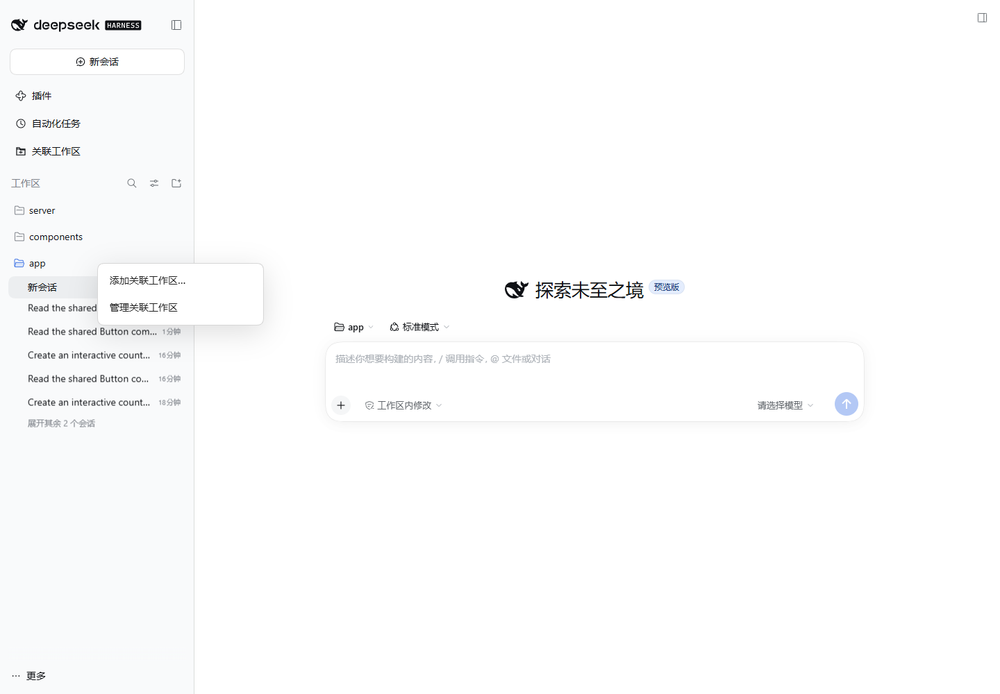

# DSH 关联工作区

为一个 DSH 项目设置主工作区，并关联组件库、后端或参考项目。在同一会话中搜索和读取这些目录，保留文件来源与目录规则。

版本：`0.3.0`。兼容 **DeepSeek Harness `0.2.1-alpha.4` 和 `0.2.1-rc.2`**，Node.js 22.19+。支持本机文件系统和 DSH Web 客户端；DSH 桌面端使用同一 Web 客户端，但当前自动化验收使用 Windows 官方发行版启动的独立 Web profile。

## 安装

从 GitHub Release 安装预构建包：

```powershell
dsh plugin --profile web add https://github.com/NingTiAn-byte/dsh-linked-workspaces/releases/download/v0.3.0/dsh-linked-workspaces.tgz --ignore-scripts --config.auto-install-peers=false
```

`web` 应替换为实际使用的 profile。Windows 桌面发行版的启动器未加入 PATH 时：

```powershell
$dshCli = Join-Path $env:LOCALAPPDATA 'Programs/DeepSeek Harness/resources/runtime/cli/bin/dsh.cmd'
& $dshCli plugin --profile web add https://github.com/NingTiAn-byte/dsh-linked-workspaces/releases/download/v0.3.0/dsh-linked-workspaces.tgz --ignore-scripts --config.auto-install-peers=false
```

按宿主提示重新启动相应 profile，并刷新页面。插件提供自己的 bundle patch，安装后无需手改 DSH 源码。发行版提供运行时 SDK peers；开发依赖不会打入安装包。

## 快捷使用



1. 在 DSH 左侧项目名称上单击鼠标右键，选择 **添加关联工作区…**。
2. 从已有工作区中选择一个，点击 **添加此工作区**；或者点击 **选择本机目录…**，在目录选择器中选中目录。
3. 自动生成别名并保存，无需填写别名、用途或再进入管理页保存。新会话会自动继承配置；已有会话仍保留快照，可在管理页显式同步。

右键菜单中的 **管理关联工作区** 会直接定位到刚才点击的项目。原来的侧栏管理页保留，用于修改别名、移除关联和同步会话。取消选择不修改配置；已有目录不可重复添加；其他窗口的并发修改不会被覆盖。

桌面端优先使用桌面目录选择桥；Web 按宿主提供的目录浏览或原生选择能力工作。目录浏览支持逐级进入、上一级、主目录及可选的路径跳转。

## 详细管理

1. 在 DSH 中添加主项目的工作区。在左侧进入「关联工作区」，选择该项目。
2. 从「从已有工作区添加」选择组件库，或点击「添加目录」填写本机绝对路径。
3. 设置稳定别名，例如 `components`、`server`。别名以小写字母开头，可含小写字母、数字、下划线和连字符，最多 32 字符。填写简短用途后保存。
4. 在面板里搜索文件名或文本，点击结果读取带行号的预览和适用的 `AGENTS.md`。结果使用 `components/src/Button.tsx` 这类名称，避免同名文件混淆。
5. 在主工作区中开始会话。模型首次处理请求时继承当时的项目配置，并获得目录清单。
6. 项目配置变化后，已有会话保留旧快照。在面板选择空闲会话并点击「同步到所选会话」，下一次模型请求采用新快照。会话标题旁的关联目录按钮可以返回管理面板。

可以对模型说：“从 components 中找到 Button 的实现，阅读它的使用约束，再在主项目中复用。”关联目录不会自动成为主项目的包依赖；复制源码、本地包链接和修改构建配置仍由实际任务决定。

会话继续属于原来的主工作区。切换主工作区请通过 DSH 的工作区入口创建或打开相应会话。移除关联只更新配置，不删除磁盘文件。

## 模型工具

| 工具 | 功能 |
| --- | --- |
| `linked_workspace_list` | 列出当前会话快照里的主目录、关联目录和当前可用状态 |
| `linked_workspace_search` | 在指定别名或全部目录进行不区分大小写的字面文件路径/文本搜索 |
| `linked_workspace_read` | 按相对路径读取带行号文本，同时返回根目录至文件父目录的 `AGENTS.md` |

工具不提供写入、删除、依赖安装或命令执行操作。原生工具模式和 PTC 使用同一注册工具；目录清单通过宿主 runtime context 进入模型历史。读取结果和目录规则通过正常工具结果记入日志，不会预先读取全部仓库内容。

规则均附带绝对适用目录，读取结果不会把关联项目规则提升为主项目的全局规则。规则发现目前只支持文件所在目录链中的 `AGENTS.md`，不额外加载 `CLAUDE.md`、用户全局规则或跨目录规则继承。

## 存储与权限

项目配置保存于 DSH `storageDomain` 的 `local_linked_workspaces` 域，使用宿主已配置的存储后端；JSON 后端下文件名是 `local_linked_workspaces.json`。配置使用工作区 ID 索引，不向用户仓库写入配置文件。保存带版本校验，其他窗口提交修改后，本窗口必须刷新再保存。

会话快照保存为 `plugin:linked-workspaces/snapshot` 可忽略记录，由注册的 `linkedWorkspaces` projection 恢复。继续会话和分叉继承已记录的快照；新的项目配置不会静默覆盖历史会话。首次使用前未创建快照的会话采用首次使用时的配置。与其他实验性插件记录一样，跨 Session 格式迁移的保留由 DSH 提供尽力支持。

管理与搜索 HTTP 接口挂在 DSH 已认证的 Connection exact Fetch route 上；两个支持版本只允许 owner Peer 调用此类路由。插件不创建额外监听端口。

**“关联工具只读”指这些工具自身没有修改操作。** 它不限制原有 shell、文件工具或其他插件，也不是新的文件系统沙箱。DSH 的现有 sandbox、提权和系统访问控制继续生效。不要把关联目录清单当作整台机器的读取白名单。

目录路径经过 `realpath` 规范化，拒绝重复、别名冲突和父子目录重叠。搜索跳过符号链接与 junction；读取拒绝最终文件符号链接，解析后的文件必须位于所选根目录内。配置的根目录目标变化后需要重新关联。不存在或不可访问的根目录会在面板和搜索结果里明确标注。

## 范围和限制

- 最多关联 16 个本机目录；不支持 SSH、容器路径或远端文件系统后端。
- 搜索排除隐藏文件/目录（`.github` 除外）、`.env`、常见私钥和凭据文件，以及 `.git`、`node_modules`、`dist`、`build`、`coverage`、`__pycache__`、`.next`、`vendor`。排除规则不等同于完整秘密检测。当前不解析 `.gitignore`。
- 文本工具不支持二进制文件。搜索有遍历、时长、单文件大小和结果数量上限；达到限制时返回 `truncated`，文件或根目录失败返回独立提示。
- 读取仅覆盖文件前 `readMaxBytes` 字节，每次 1–300 行；超出前缀的内容需使用宿主现有工具在其权限下阅读。规则文件共享单次规则字节预算。
- 同一 DSH 实例内支持并发窗口的版本冲突检测。不要让多个独立 DSH 进程同时写同一个 JSON 存储目录；其多进程写入语义由宿主存储后端决定。
- 第一版不统一各仓库 Git 操作、不安装依赖、不建立构建联动，不增加跨目录写权限。

## 配置

在插件配置中覆盖这些整数值：

| 字段 | 默认值 | 含义 |
| --- | ---: | --- |
| `readMaxBytes` | 65536 | 单次文件前缀读取上限 |
| `instructionMaxBytes` | 16384 | 单次返回规则总字节预算 |
| `searchFileMaxBytes` | 65536 | 文本搜索的单文件前缀上限 |
| `searchMaxResults` | 40 | 单次搜索结果上限 |
| `searchMaxEntries` | 10000 | 单次搜索遍历条目上限 |
| `searchMaxWarnings` | 30 | 最多返回的文件提示条数，另保留提示总数 |
| `searchTimeoutMs` | 5000 | 搜索合作式时间预算，文件系统调用返回后检查 |
| `previewChars` | 240 | 单条搜索结果的文本预览字符上限 |

模型上下文只包含目录清单和使用说明，长度随关联数量增长。搜索、读取和规则内容按需进入工具历史，受上述配置限制。

## 开发与验收

```powershell
npm ci --ignore-scripts
npm run check
npm test
npm pack --ignore-scripts --cache ./artifacts/npm-cache
```

单元与模型循环测试使用 rc.2 发布 SDK、真实 Session/projection 和 JSON storage；模型响应使用固定脚本，不需要 API Key。覆盖同名文件、来源、规则作用域、越界路径、链接、二进制文件、缺失目录、取消、截断、并发保存、会话恢复及显式同步。

真实页面验收使用独立 DSH home，避免改动用户 profile：

```powershell
$env:DSH_HOME = Join-Path (Get-Location) 'artifacts/live-home'
& $dshCli --profile linked-workspaces-test --from-default-profile web --dump-config
node scripts/prepare-live.mjs
& $dshCli plugin --profile linked-workspaces-test add ./local-dsh-linked-workspaces-0.3.0.tgz --ignore-scripts --offline --config.auto-install-peers=false
& $dshCli --profile linked-workspaces-test --patch artifacts/live.overlay.yml --port 7362 --no-open
# 在另一个终端运行，使用上一条命令输出的认证 URL：
npm run test:live -- 'http://127.0.0.1:7362/?token=...'
```

`node scripts/prepare-live.mjs` 会生成带当前 checkout 路径的本地 overlay，生成文件不提交到 GitHub。fixture 只创建 `artifacts/example` 下的演示目录和隔离 profile 内的测试会话，不打入插件包。页面测试使用本机无头 Edge，可通过 `DSH_TEST_BROWSER` 指定浏览器，保存报告和宽窄屏截图到 `artifacts/`。

## 双版本兼容

同一个安装包适用于两个版本，项目配置和会话快照采用相同格式，无需转换。运行时使用宿主提供的共享 SDK，不自动安装另一版本宿主。安装时保留 `--ignore-scripts --config.auto-install-peers=false`，并选择实际使用的 profile；重启后刷新页面。

本版本只承诺 alpha.4 与 rc.2，不泛化为所有中间版本。开发时仍使用锁文件中的 rc.2 SDK；可通过 `DSH_TEST_HOST_SOURCE` 指向已构建的 alpha.4 源码后运行 `npm run test:host`，验证实际 alpha.4 SDK，而不是混用两个版本。

## 项目右键菜单的兼容方式

alpha.4 和 rc.2 尚未公开项目级菜单条目的插件插槽。插件在公开的 `shell.overlay` 插槽中挂载自己的菜单和对话框，通过这两个版本共同使用的 `data-row-key="workspace:…"` 识别目标项目。只处理项目行的右键事件，不替换宿主的项目“…”菜单，也不修改宿主源码。项目行结构变化的后续 DSH 版本需要重新验证；原管理入口可独立使用。

目录选择使用 `uiWorkspace` 的目录能力和桌面原生桥；保存继续走已有 owner-only API、目录边界检查和 revision 冲突检测，不增加磁盘写权限。弹出层支持 Escape、菜单方向键和 Tab 焦点约束，卸载时撤销监听和未完成请求。

开发者可用 `DSH_TEST_URL` 和 `DSH_TEST_ARTIFACT_DIR` 指向隔离测试服务及其 fixture，再运行 `node tests/quick-live.mjs`，检查右键、取消、自动别名、重复目录、真实目录浏览、并发保存、延迟选择结果及重载持久化。测试 fixture 不包含在安装包中。
